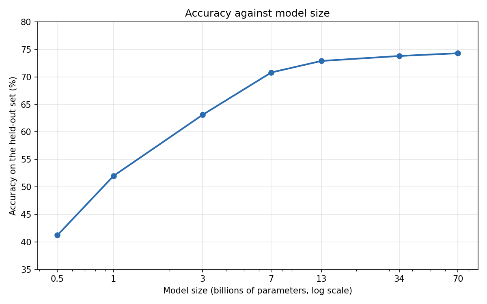
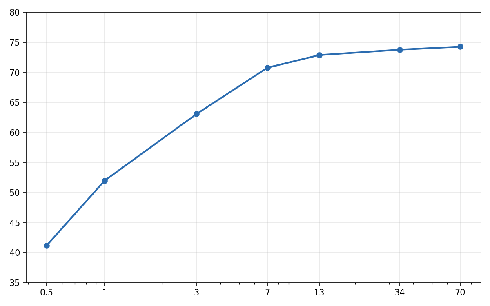

<!-- design: summary box titled "In this release", shown before the first heading -->

AutoRubric {{ release }} was released on {{ release_date }}. It has two main changes.

- **Image inputs.** A submission can now hold images as well as text, so a rubric can ask about a chart, a screenshot or a scanned page. LLM judges and decision models both grade them, and dataset files store them.
- **Cheaper per-criterion grading.** Per-criterion prompts are reordered so that a provider's prompt cache can reuse the submission across an item's calls. In our runs the cost of per-criterion grading fell by nearly a quarter for two of the three judges.

The release also tells the meta-judge that it is reading a rubric, and makes a misconfigured judge, including one whose account is out of credits, raise an error where it used to abstain. Upgrade with:

```bash
pip install -U autorubric
```

## Why would a rubric need to see an image?

Many submissions carry their evidence in a picture. A lab report is judged partly on its figures, a design review on its screenshots, and a scanned exam on handwriting. A judge that reads only text cannot check a criterion such as "Both axes of the chart are labelled, with units".

Take two students, Alice and Bob, who plotted the same results and wrote a caption each. The rubric has three criteria: `axes` (weight 5), `trend` (weight 10) and `chart_type` (weight 5). The verdicts below are the ones a teaching assistant would give. They are not the output of a model.

<!-- design: the two reports side by side, each a card holding the chart, its caption and its three verdicts -->



| Criterion | Requirement | Verdict | Why |
|---|---|---|---|
| `axes` | Both axes of the chart are labelled, with units | MET | Model size in billions of parameters; accuracy in % |
| `trend` | The caption states the trend the chart shows | MET | The curve climbs to 7B and is nearly flat after it, as the caption says |
| `chart_type` | The chart type suits the data shown | MET | A line over ordered sizes, on a log axis that spaces them evenly |



| Criterion | Requirement | Verdict | Why |
|---|---|---|---|
| `axes` | Both axes of the chart are labelled, with units | UNMET | Neither axis has a label, so neither has units |
| `trend` | The caption states the trend the chart shows | UNMET | The curve levels off above 7B; it does not keep climbing steadily |
| `chart_type` | The chart type suits the data shown | MET | The same line chart as Alice's |

Bob's caption reads as a fine caption on its own. Only a judge that sees the chart can tell that the curve flattens above 7B, so a judge that reads only the captions cannot grade `trend`.

## How do I grade a submission that holds images?

A submission is now `Content`, which is a string, an `Image`, or a list of strings and images. The judge reads a list in order, so a chart followed by its caption reaches the judge as a chart followed by its caption.

```python
from autorubric import Criterion, Image, LLMConfig, Rubric
from autorubric.graders import CriterionGrader

report = [
    Image("reports/alice/chart.png"),
    "Figure 1. Accuracy rises with model size and levels off above 7B parameters.",
]

rubric = Rubric([
    Criterion(name="axes", weight=5.0, requirement="Both axes of the chart are labelled, with units"),
    Criterion(name="trend", weight=10.0, requirement="The caption states the trend the chart shows"),
    Criterion(name="chart_type", weight=5.0, requirement="The chart type suits the data shown"),
])

grader = CriterionGrader(judge_model_config=LLMConfig(model="openai/gpt-5.6-luna"))
result = await rubric.grade(
    to_grade=report,
    grader=grader,
    query="Plot accuracy against model size and interpret the result in a caption.",
)
```

`Image(path)` reads nothing when it is created. The file is read once per grade, before any judge is called. A missing or unreadable file raises an error from the grade, so a broken path never turns into a verdict. `Image(data)` takes bytes you already hold. An image is PNG, JPEG, GIF or WebP.

The query and the reference submission are `Content` as well. A task prompt can therefore show the data a chart was made from, and a reference can be a model answer's chart. For LLM judges, few-shot training items may hold images too.

## Which judges can be sent images?

AutoRubric grades with two kinds of AI judges, LLMs and decision models, and each kind handles images differently.

### LLM judges

An LLM judge such as OpenAI's `gpt-5.6-luna` or Google's `gemini-3.8-flash` receives each image inside the prompt, at the place where it occurs in the submission. The original bytes are sent. AutoRubric does not convert or resize them.

An image is sent only to a model that is known to accept images. The first time a grader is about to send an image, it looks the model up in LiteLLM's model map. A model that the map does not list as accepting images raises a `ValueError` that names the judge and the model, before any judge sends a request. This check covers every judge that could receive the image, including each member of a panel and a cascade's escalation judges.

LiteLLM's map does not hold every vision model. Models served through Ollama, vLLM or OpenRouter are often missing from it. If your model does accept images, declare it on the judge's configuration.

```python
from autorubric import LLMConfig
from autorubric.graders import CriterionGrader

llava = LLMConfig(model="ollama/llava", images=True)  # declares that the model accepts images
grader = CriterionGrader(judge_model_config=llava)
result = await rubric.grade(to_grade=report, grader=grader)
```

### Decision models

A decision model answers the whole rubric in one request. Jev accepts images from `jev-1.14.0` on.

```python
from autorubric import DecisionModelConfig
from autorubric.graders import CriterionGrader

jev = DecisionModelConfig(model="jev-1.14.0")  # needs pip install 'autorubric[typesafe]'
grader = CriterionGrader(judge_model_config=jev)
result = await rubric.grade(to_grade=report, grader=grader)
```

Jev reads only PNG and JPEG images whose sides are between 280 and 1568 pixels, and it does not resize images itself. AutoRubric therefore fits each image before sending it. An image already inside these limits is sent unchanged. Any other image is re-encoded as PNG or JPEG, scaled to fit, and padded with white when a side is still too short.

Which decision models accept images comes from a registry that ships with AutoRubric. A model the registry lists as text-only, such as `jev-1.13.0`, or does not list at all, raises a `ValueError` as soon as the content holds an image, and no judge sends a request. For an unlisted model, such as a self-hosted endpoint, pass its limits as `DecisionModelConfig(model=..., capabilities={...})`.

### Formats at a glance

| Judge | Formats sent | What AutoRubric does |
|---|---|---|
| LLM judges | The image's own format | Sends the original bytes, never converted or resized, and only to a model known to accept images. The provider's limits on formats, size and number of images apply. |
| Jev (`jev-1.14.0`, `jev-latest`) | PNG and JPEG only | Fits every image by converting other encodings, scaling, and padding with white. |

PNG and JPEG are the safe choice for every judge. GIF and WebP are not accepted by every provider or model.

## Explanations

As with all AutoRubric grading, an LLM judge that grades an image explains each verdict. Every criterion in the report carries its verdict and the judge's reason.

```python
for item in result.report:
    print(f"[{item.final_verdict.value}] {item.criterion.name}: {item.final_reason}")
```

For Bob's report, the judge marked `axes` as not met. This is the line it printed, from one run with `gpt-5.6-luna`. `default` is the id of the single judge.

```text
[UNMET] axes: default: The chart shows numeric tick marks, but neither axis has a descriptive label or units (e.g., model size and accuracy percentage).
```

<!-- design: callout -->

**Decision models.** Grading with a decision model does not produce explanations. A decision model returns probabilities and not text, so its `reason` is `None`.

## How are images stored in a dataset file?

In a dataset file an image is an object whose only key is `"image"`, and a submission that mixes text and images is an array.

```json
{
  "submission": [
    {"image": "reports/alice/chart.png"},
    "Figure 1. Accuracy rises with model size and levels off above 7B parameters."
  ],
  "description": "alice",
  "ground_truth": ["MET", "MET", "MET"]
}
```

When a dataset is loaded with `RubricDataset.from_file`, a relative path is resolved against the directory of the dataset file, so the file and its folder of figures can be moved or shared together. Loading a dataset opens no image. A dataset whose figures are missing still loads, and the missing file is reported when its item is graded.

<!-- design: callout -->

**Memory.** Each item being graded holds its images in memory until its grade finishes. `evaluate()` starts every item at once unless `max_concurrent_items` is set, so for an image dataset set it to a few times the number of requests your provider allows in parallel.

```python
from autorubric import evaluate

result = await evaluate(dataset, grader, max_concurrent_items=32, show_progress=False)
```

## What changed in the cost of per-criterion grading?

By default an LLM judge is called once per criterion, and every call re-sends the submission. A provider's prompt cache can discount the repeated part, but only when the repeated part comes first. Before {{ release }} the criterion came first, which kept providers from reusing the submission across an item's calls.

Without few-shot examples, a per-criterion prompt now runs in this order: guidelines, input, reference submission, submission, criterion. With examples, which differ per criterion, the examples and the criterion come after the guidelines and before the input. Few-shot examples also name a multi-choice option by its label now, where they used a number. The rest of the text is unchanged, and decision-model requests do not change.

We re-ran nine datasets (5,003 criterion judgments) with three judges under the old and the new order.

<!-- design: cost table with a small before/after bar per judge -->

| Judge | Cost before | Cost after | Cached prompt tokens before | Cached prompt tokens after |
|---|---|---|---|---|
| `gpt-5.6-luna` | \$1.84 | \$1.40 | 80% | 91% |
| `deepseek-v4.1-flash` | \$4.18 | \$3.23 | 68% | 82% |
| `gemini-3.8-flash` | \$20.59 | \$20.68 | none | about 1% |

Cost fell for the two judges whose caches these prompts could reach. Gemini's prompts in these runs were below its 4,096-token minimum for caching, so its cost stayed about the same. Longer submissions and images should reach that minimum more often.

Few-shot examples are now cached across items as well. We measured this on 500 few-shot criterion calls per judge, over 40 RiceChem answers and 30 ELLIPSE essays with five examples each. For `gpt-5.6-luna` the share of cached prompt tokens rose from 53% to 89% and the cost fell from \$0.354 to \$0.207. Cost also fell for `claude-haiku-5-5` and `gemini-3.8-flash`. It rose for `deepseek-v4.1-flash`, from \$0.616 to \$0.724, because that judge wrote more output in the run.

### Will my scores change?

Some verdicts will. We repeated 10% of the judgments to separate the effect of the new order from run-to-run noise. Two runs of the new order agreed on 86.4% of `gpt-5.6-luna`'s verdicts, while the old and new orders agreed on 81.1%. The order itself therefore moves some verdicts.

Accuracy against the datasets' labels changed by −0.4 points for `gpt-5.6-luna` (95% interval −1.3 to +0.5), by +0.5 for `deepseek-v4.1-flash` (−0.5 to +1.5) and by −1.4 for `gemini-3.8-flash` (−2.1 to −0.8). If you compare scores across this upgrade, re-grade a sample with both versions first.

## What else is in {{ release }}?

- **The meta-judge is told what it is reading.** Meta-rubric evaluation grades a rubric. The meta-judge now receives an instruction that its submission is a rubric and not a response to grade. Without it, judges could fault a rubric for containing no response. Meta-rubric scores can change.
- **A misconfigured judge raises an error.** A rejected or missing key, an unknown model, a parameter LiteLLM refuses, or an account that is out of credits (a 402 Payment Required answer) now makes the grade raise a `ValueError` that names the judge. The call is not retried. Before, each such call abstained, so under the default `SKIP` strategy a run could reach its end with every affected item left without a score. `evaluate()` records the error on each affected item and goes on, or stops at the first one with `fail_fast=True`.
- **Invalid settings are refused when they are built.** `LLMConfig` refuses an invalid `thinking`, `max_tokens` or `top_p`. `FewShotConfig` refuses an example count that is not a positive integer, `CriterionGrader` refuses a seed that is not an integer, and a criterion refuses two options with the same label.
- **Response caches keep working.** Cache directories written by earlier releases still load, so upgrading does not pay again for calls you have already made. Replies cached for meta-rubric evaluation are the exception, because its prompt changed. A run that reads an older cache can return verdicts generated under the old prompt order. Clear the cache to get replies generated under the new one.
- **Unfinished runs resume.** Resuming an experiment from an earlier release grades its remaining items in the new order, so that run mixes the two orders. Start a new experiment if you need a single order.

## Questions

<!-- design: FAQ; also emit FAQPage structured data from these questions and answers -->

### Which image formats does AutoRubric accept?

PNG, JPEG, GIF and WebP. LLM judges receive an image in its own format. Jev receives PNG or JPEG, and AutoRubric converts other formats for it.

### Does AutoRubric resize my images?

Not for LLM judges, which receive the original bytes. For Jev, an image outside 280 to 1568 pixels per side is scaled, and padded with white if a side is still too short.

### Can I send an image to a model that LiteLLM does not list as a vision model?

Yes. Set `images=True` on the judge's `LLMConfig`. Without that declaration the grade raises an error before any request is sent.

### Do I have to change my code to upgrade?

Usually not. Valid text-only code runs unchanged, although some verdicts change with the new prompt order. A misconfigured judge now raises an error where it used to abstain, and invalid settings are refused when they are built. A custom grader that annotates `judge` arguments as `str` still runs, though a type checker will ask for `Content`.

### Do I need to re-run old experiments?

Only if you compare scores across the upgrade. The new prompt order changes some verdicts, so re-grade a sample with both versions before comparing.

## Where to go next

- [Grading Submissions with Images]({{ site.url }}/docs/cookbook/image-inputs/), the full recipe behind this post
- [Fundus Image Quality (EyeQ)]({{ site.url }}/docs/cookbook/fundus-image-quality/), a worked use case that grades retinal photographs
- [Upgrade Notes]({{ site.url }}/docs/upgrading/), with every measurement for {{ release }}
- [Decision-Model Judges]({{ site.url }}/docs/cookbook/decision-models/)
