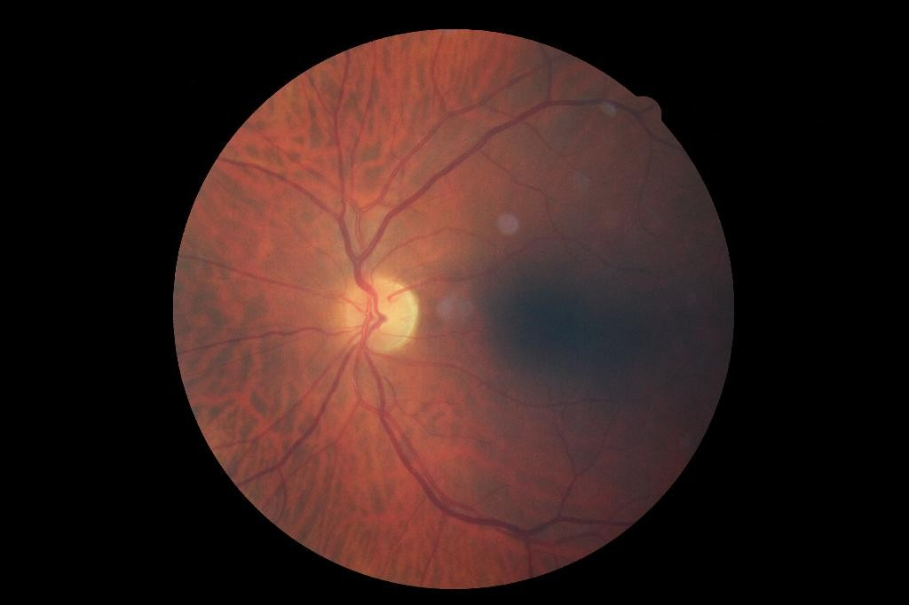

# Fundus Image Quality (EyeQ)

Grade retinal photographs for whether they are good enough for diabetic retinopathy screening, using a rubric built from a published grading protocol and an LLM judge that sees each image.

## The Scenario

A screening program photographs the back of each patient's eye (the fundus) and sends the photographs to graders. A blurred, dark or badly framed photograph wastes a grader's time and can hide disease, so the program wants each photograph checked first. A good photograph is passed on; a usable one is passed on with a flag; one that must be retaken is sent back.

[EyeQ](https://github.com/hzfu/EyeQ) (Fu et al., MICCAI 2019) is a public set of 28,792 such photographs from the EyePACS screening program. Experts graded each one as Good, Usable or Reject, using written rules. This recipe grades a tiny subset of EyeQ with `gemini/gemini-3.8-flash` and compares the judge's grades with the experts'.

## What You'll Learn

- Turning a written grading protocol into rubric criteria
- Deriving ground truth for every criterion from one expert label
- Grading image submissions with an LLM judge
- Reading the evaluation report, and the judge's reasoning where it disagrees with the experts

## Getting the Data

EyeQ publishes labels only. Its images are the EyePACS photographs from Kaggle's [Diabetic Retinopathy Detection](https://www.kaggle.com/c/diabetic-retinopathy-detection) competition, which you download with your own Kaggle account after accepting the competition's rules.

1. Download `data/Label_EyeQ_train.csv` from the [EyeQ repository](https://github.com/hzfu/EyeQ). Each row names an EyePACS image and its grade, coded `0` (Good), `1` (Usable) or `2` (Reject).

    ```text
    ,image,quality,DR_grade
    0,10_left.jpeg,0,0
    ```

2. Get the images. The competition ships them as multipart zips of about 85 GB in all, which is far more than a tiny subset needs. The Kaggle dataset `tanlikesmath/diabetic-retinopathy-resized` holds the training images resized to 1024 pixels wide, under their original filenames, and the Kaggle CLI can download them one at a time (about 40 KB each):

    ```bash
    kaggle datasets download tanlikesmath/diabetic-retinopathy-resized -f resized_train/resized_train/11937_left.jpeg -p eyepacs
    ```

    Download a few images of each grade, chosen from the label file, into one folder. The script grades only images whose files are in that folder.

## The Solution

The full script is [`examples/eyeq_fundus_quality.py`](https://github.com/delip/autorubric/blob/main/examples/eyeq_fundus_quality.py). The steps below walk through it.

### Step 1: Write the Rubric from the Protocol

EyeQ's paper defines each grade in a sentence. The grades become the options of one ordinal criterion, and the sentences go into the criterion's requirement, so the judge reads the same rules the experts used:

| Grade | Rule |
|---|---|
| Good | No low-quality indicators, and every retinal structure is clearly visible |
| Usable | The optic disc and macula are present, but low-quality indicators (blur, uneven illumination, over- or under-exposure, artifacts) affect at most 20% of the fundus |
| Reject | The optic disc or the macula is missing, or low-quality indicators cover more than 20% of the fundus |

A second, binary criterion asks the question the screening program acts on: can the photograph be used at all? It is MET for Good and Usable photographs and UNMET for rejected ones.

```python
from autorubric import Criterion, CriterionOption, Rubric

GRADES = {0: "Good", 1: "Usable", 2: "Reject"}

rubric = Rubric([
    Criterion(
        name="quality_grade",
        weight=10.0,
        requirement=(
            "Grade the quality of this retinal fundus photograph for diabetic "
            "retinopathy screening, using these rules. "
            "Good: no low-quality indicators, and every retinal structure is clearly "
            "visible. "
            "Usable: the optic disc and macula are present, but low-quality indicators "
            "(blur, uneven illumination, over- or under-exposure, artifacts) affect at "
            "most 20% of the fundus. "
            "Reject: the optic disc or the macula is missing, or low-quality indicators "
            "cover more than 20% of the fundus."
        ),
        scale_type="ordinal",
        options=[
            CriterionOption(label=GRADES[0], value=1.0),
            CriterionOption(label=GRADES[1], value=0.5),
            CriterionOption(label=GRADES[2], value=0.0),
        ],
    ),
    Criterion(
        name="gradeable",
        weight=5.0,
        requirement="The photograph can be used for screening: the optic disc and the "
                    "macula are both in view, and low-quality indicators cover at most "
                    "20% of the fundus",
    ),
])
```

The two criteria are not independent: a judge that grades a photograph Reject should also find it not gradeable. Reading them side by side shows when the judge contradicts itself.

### Step 2: Build a Tiny Dataset

The script draws two photographs of each grade (six in all) with a fixed seed, so the subset covers every grade. EyePACS photographs are up to about 4000 pixels on a side, so each one is shrunk to at most 1024 pixels and passed to `Image` as JPEG bytes, which keeps requests small. Both criteria's labels come from the one EyeQ grade:

```python
import io

import PIL.Image as pil_image

from autorubric import Image, RubricDataset


def downsized(path, max_side=1024):
    with pil_image.open(path) as im:
        im = im.convert("RGB")
        im.thumbnail((max_side, max_side))
        buf = io.BytesIO()
        im.save(buf, format="JPEG", quality=90)
    return Image(buf.getvalue())


dataset = RubricDataset(
    prompt="A retinal fundus photograph taken for diabetic retinopathy screening.",
    rubric=rubric,
    name="eyeq-poc",
)
for row in rows:  # rows sampled from Label_EyeQ_train.csv
    grade = int(row["quality"])
    dataset.add_item(
        submission=downsized(images_dir / row["image"]),
        description=row["image"],
        ground_truth=[GRADES[grade], "UNMET" if grade == 2 else "MET"],
    )
```

A multi-choice label is the option's label text, so the ground truth for `quality_grade` is `Good`, `Usable` or `Reject`.

### Step 3: Grade with Gemini

```python
from autorubric import LLMConfig, evaluate
from autorubric.graders import CriterionGrader

grader = CriterionGrader(
    judge_model_config=LLMConfig(model="gemini/gemini-3.8-flash"), seed=0
)
result = await evaluate(dataset, grader, max_concurrent_items=4, show_progress=False)
```

LiteLLM's model map lists `gemini-3.8-flash` as accepting images, so autorubric sends each photograph to it. `max_concurrent_items` bounds how many photographs are held in memory at once (see [Grading Submissions with Images](image-inputs.md)). The judge is called once per criterion, so six photographs make twelve calls.

### Step 4: Read the Evaluation Report

```python
metrics = result.compute_metrics(dataset)
print(metrics.summary())
```

The summary compares the judge's verdicts with the expert labels. This is the per-criterion part of one run on six EyeQ training photographs, two of each grade:

```text
Binary Criteria:
Criterion                 Acc     Prec      Rec       F1    Kappa      Phi    FP    FN     FPR     FNR
------------------------------------------------------------------------------------------------------
gradeable               83.3%     1.00     0.75     0.86    0.667    0.707     0     1    0.00    0.25

Ordinal Criteria:
Criterion               Exact      Adj   WKappa   Spearman     RMSE
-------------------------------------------------------------------
quality_grade           50.0%   100.0%    0.571     0.8165   0.3536
```

The judge gave the experts' grade for three of the six photographs. Each of the other three was one grade off (`Adj` is 100%). Both Good photographs were graded Usable, and one Usable photograph was graded Reject, so the judge was stricter than the experts. It also called that Usable photograph not gradeable, its one `gradeable` error (`FN` is 1). The weighted score has a mean bias of −0.22 for the same reason. The run cost $0.06.

To compare judges, rerun with another model on the same photographs (`--model gemini/gemini-4-argon`). The two runs, on the same six photographs:

| | gemini-3.8-flash | gemini-4-argon |
|---|---|---|
| `gradeable` accuracy | 5 of 6 | 6 of 6 |
| `quality_grade` exact match | 3 of 6 | 5 of 6 |
| `quality_grade` within one grade | 6 of 6 | 6 of 6 |
| `quality_grade` weighted kappa | 0.571 | 0.889 |
| Score RMSE | 0.333 | 0.136 |
| Score mean bias | −0.22 (stricter than the experts) | +0.06 (more lenient) |
| Cost | $0.06 | $0.09 |

gemini-4-argon agreed with the experts' grade on two more photographs, including `11937_left` (below). Its one miss went the other way from flash's: it graded a Usable photograph Good, saying it saw "no low-quality indicators". On six photographs, one or two photographs separate the two judges, so the table shows how to compare judges, not which judge is better.

Six photographs are enough to show the pipeline working, not to measure the judge. Before trusting it, run it on a few hundred photographs and look at the confidence intervals (see [Judge Validation](judge-validation.md)).

### Step 5: Look at a Disagreement

Where the judge and the experts disagree, the script saves the photograph to `eyeq_failures/` and prints the judge's reasoning beside both verdicts:

```python
for r in result.item_results:
    for cr, truth in zip(r.report.report, r.item.ground_truth, strict=True):
        mc = cr.final_multi_choice_verdict
        predicted = mc.selected_label if mc else cr.final_verdict.value
        truth = getattr(truth, "value", truth)
        if predicted != truth:
            print(r.item.description, cr.criterion.name)
            print("  truth:    ", truth)
            print("  predicted:", predicted)
            print("  reasoning:", cr.final_reason)
```

The reasoning says what the judge saw in the photograph: whether it found the optic disc and macula, and which low-quality indicators it noticed and how much of the fundus it thought they covered. That is the evidence for deciding whether the judge, the rubric wording, or the expert label is wrong.

In the gemini-3.8-flash run, the experts graded this photograph Usable and the judge graded it Reject:

<figure markdown="span">
  { width="560" }
  <figcaption>EyePACS 11937_left. EyeQ grade: Usable.</figcaption>
</figure>

```text
11937_left.jpeg [quality_grade]
  truth:     Usable
  predicted: Reject
  reasoning: default: A prominent dark artifact and uneven illumination obscure the macular region and cover more than 20% of the fundus, meeting the criteria for Reject.

11937_left.jpeg [gradeable]
  truth:     MET
  predicted: UNMET
  reasoning: default: The photograph is unusable for diabetic retinopathy screening because a large shadow artifact directly obscures the macular region, preventing adequate visualization of the macula.
```

The dark region the judge calls an artifact is where the macula lies, and the macula normally looks darker than the rest of the retina. We think the judge mistook it for an illumination artifact, though only a grader could say how much of the darkness is real shadow. The judge made the same reading in both of its calls, so the two verdicts agree with each other and both disagree with the experts. A judge reading the photograph differently in its two calls would show as a `quality_grade` and a `gradeable` verdict that contradict each other; comparing the criteria of one item catches that.

The two Good photographs that the judge graded Usable show the same strictness. For one, the judge again saw "a localized dark shadow/artifact over the macular region"; for the other, it described "slight haziness/blur and uneven illumination". EyeQ's Good grade allows no low-quality indicators at all, so the judge applied the rule more literally than the experts did. A requirement that says which minor flaws a Good photograph may still have would test that.

## Running It

```bash
uv run python examples/eyeq_fundus_quality.py --labels Label_EyeQ_train.csv --images eyepacs --per-grade 2
```

It needs `GEMINI_API_KEY`. Raise `--per-grade` for a larger sample, change `--seed` for a different one, and pass `--model` to use another judge (the default is `gemini/gemini-3.8-flash`).

!!! note "Licence"
    The EyeQ labels are on GitHub. The EyePACS images are under Kaggle's competition rules, so check those rules before you publish images or results.
